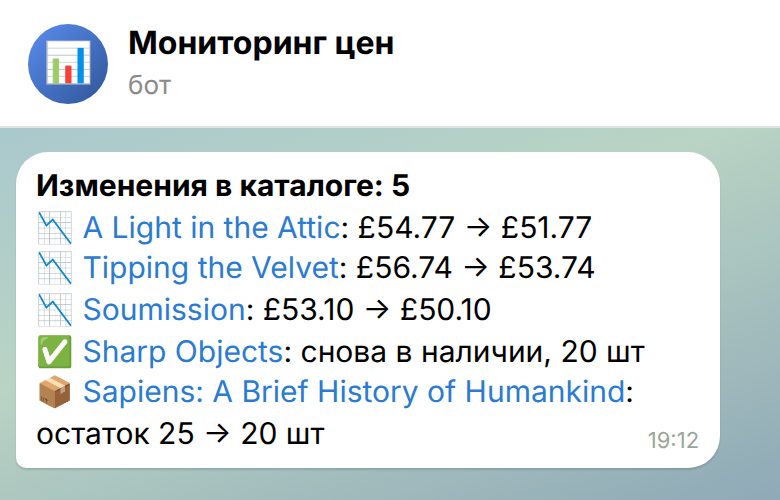
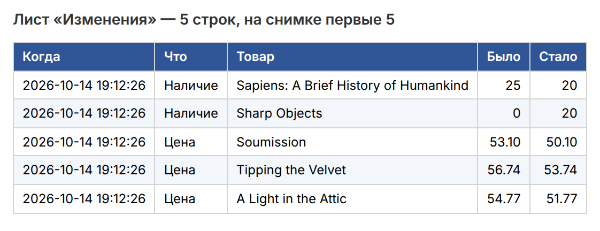
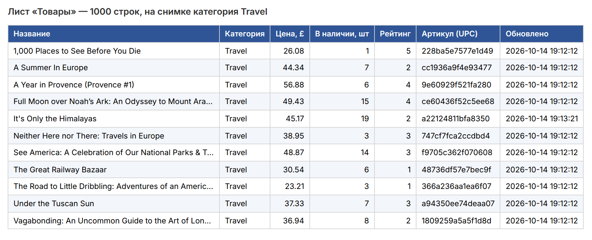

# Парсер каталога с выгрузкой в таблицу и уведомлениями в Telegram

Собирает с сайта все товары — название, категорию, цену, остаток, рейтинг,
артикул и ссылку — и складывает их в Excel или Google Таблицу. Запускается
по расписанию; когда меняется цена или наличие, появляется новый товар или
пропадает старый, присылает сводку в Telegram.

> Это демо на [books.toscrape.com](https://books.toscrape.com) — учебном
> магазине, сделанном специально для парсинга: 1000 книг на 50 страницах.
> Под другой сайт меняется один модуль разбора страниц.

## Как выглядит

| Уведомление в Telegram | Изменения в таблице |
|---|---|
|  |  |

Лист «Товары» — все 1000 позиций, на снимке одна категория:



Снимки собраны из настоящего запуска: таблица — первые строки выгруженного
файла, уведомление — тот же текст, что уходит в Telegram
(`tools/render.py`, `tools/shoot.py`).

## Что умеет

- обходит все страницы каталога сам, по ссылке «дальше»; карточки товаров
  грузит в несколько потоков — 1000 товаров примерно за минуту;
- поля: название, категория, цена, остаток в штуках, рейтинг, артикул,
  ссылка, время обновления;
- Excel с двумя листами: «Товары» (фильтры, закреплённая шапка, цены
  числами) и «Изменения» (история: когда, что, было → стало);
- Google Таблица — те же два листа, если указан id таблицы и ключ
  сервисного аккаунта;
- уведомление в Telegram только когда что-то изменилось: цена вниз/вверх,
  товар закончился или снова появился, новый товар, товар пропал с сайта;
  длинный список режется на сообщения, больше 30 изменений — сводка;
- запуск по расписанию: `--every 60` раз в час или через cron.

**Надёжность**
- сеть моргнула — до трёх повторов с паузой; одна битая карточка не
  останавливает обход, а попадает в журнал;
- сайт лёг или сменил вёрстку — парсер падает с понятной ошибкой и не
  затирает старую таблицу пустой;
- «пропал с сайта» ставится только после полного обхода, без сбоев:
  иначе обрыв на середине выглядел бы как исчезновение половины каталога;
- первый запуск только запоминает каталог, без уведомления на 1000 строк;
- файл Excel пишется через временный, поэтому открытый в этот момент файл
  не окажется битым;
- ключи и токены только в `.env`.

## Как запустить

Нужен Python 3.11+.

```bash
python -m venv .venv
.venv/bin/pip install -r requirements.txt
cp .env.example .env          # при желании — токен бота и id чата, id Google Таблицы
.venv/bin/python -m pricewatch             # один проход
.venv/bin/python -m pricewatch --every 60  # раз в час, пока не остановишь
.venv/bin/python -m pricewatch --pages 2   # быстрая проверка: только 2 страницы
```

Результат — `out/products.xlsx`, база снимков — `data/pricewatch.db`.

Через cron вместо `--every`:

```
0 * * * * cd /opt/pricewatch && .venv/bin/python -m pricewatch >> pricewatch.log 2>&1
```

**Telegram.** Создать бота у @BotFather, вписать токен в `TG_TOKEN`, написать
боту любое сообщение и вписать свой id в `TG_CHAT_ID` (подойдёт и id группы).

**Google Таблица.** Создать сервисный аккаунт в Google Cloud, скачать его
ключ JSON и указать путь в `GOOGLE_CREDENTIALS`; расшарить таблицу на почту
аккаунта с правом редактирования; id из адреса таблицы — в `GSHEET_ID`.

## Устройство

| Файл | Что делает |
|---|---|
| `pricewatch/parse.py` | разбор страниц списка и карточки товара — единственное, что меняется под другой сайт |
| `pricewatch/fetch.py` | загрузка страниц: повторы, таймаут, пауза между запросами |
| `pricewatch/crawl.py` | обход всех страниц, карточки — в несколько потоков |
| `pricewatch/store.py` | снимки в SQLite и поиск изменений между запусками |
| `pricewatch/export.py` | Excel и Google Таблица |
| `pricewatch/notify.py` | тексты и отправка уведомлений в Telegram |
| `pricewatch/__main__.py` | запуск и расписание |

## Проверки

```bash
.venv/bin/pip install -r requirements-dev.txt
.venv/bin/python -m pytest -q
.venv/bin/ruff check .
```

- **Сбор и Excel** — прогнан на живом сайте: 50 страниц, 1000 товаров,
  без ошибок; изменения цены и остатка найдены на втором запуске.
- **Тесты без сети** — разбор на сохранённых страницах сайта, обход с битой
  карточкой и битой страницей, поиск изменений, тексты уведомлений, два
  запуска подряд от сайта до Excel и Telegram.
- **Telegram и Google Таблица** — проверены на тестах без подключения:
  проверяется сам запрос, живая отправка — при настройке у заказчика.
